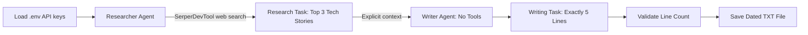

# CrewAI Tech Newsletter

A two-agent [CrewAI](https://www.crewai.com/) application that researches today's top three technology stories and writes a concise **five-line newsletter**. The result is saved to a UTF-8 text file named with today's date.

## Workflow



The crew runs with `Process.sequential` and `verbose=True`. The Writer receives the Researcher's task result through `context=[research_task]` rather than relying on task order alone.

## Features

- **Researcher agent:** Searches the web with `SerperDevTool` for the top three technology stories of the day, including headlines, summaries, publication dates, and source URLs.
- **Writer agent:** Has no tools and summarizes only the research it receives.
- **Two tasks:** Research first, newsletter writing second.
- **Five-line output:** One heading/date line, three story lines, and one takeaway line.
- **Validation:** Raises an error if the generated newsletter does not contain exactly five non-empty lines.
- **Dated file:** Saves to `output/Tech_Newsletter_YYYY-MM-DD.txt` using the `Asia/Kolkata` timezone. A second run on the same date overwrites that day's file.
- **Environment-based credentials:** Reads `OPENAI_API_KEY` and `SERPER_API_KEY` from environment variables (with `.env` support).

## Prerequisites

- Python 3.10 or newer
- An [OpenAI API key](https://platform.openai.com/api-keys)
- A [Serper API key](https://serper.dev/)

## Project structure

```text
NewReader_CrewAgent/
├── main.py
├── README.md
├── requirements.txt
├── .env                 # Local secrets; do not commit
├── .gitignore
└── output/
    └── Tech_Newsletter_2026-10-22.txt  # Example dated output
```

## Installation

1. Create and activate a virtual environment:

   **Windows PowerShell**
   ```powershell
   python -m venv .venv
   .\.venv\Scripts\Activate.ps1
   ```

   **macOS / Linux**
   ```bash
   python3 -m venv .venv
   source .venv/bin/activate
   ```

2. Install dependencies:

   ```bash
   pip install crewai crewai-tools python-dotenv
   ```

   Or create `requirements.txt` containing:
   ```text
   crewai
   crewai-tools
   python-dotenv
   ```
   Then run `pip install -r requirements.txt`.

3. Create a `.env` file in the project root:

   ```dotenv
   OPENAI_API_KEY=your_openai_api_key
   SERPER_API_KEY=your_serper_api_key
   ```

4. Add the following to `.gitignore`:

   ```gitignore
   .env
   .venv/
   __pycache__/
   *.pyc
   ```

## Run

Place the CrewAI implementation in `ResearcherAgent.py`, including the final file-writing step, then execute:

The program will:

1. Load both API keys and initialize the LLM and Serper search tool.
2. Run the Researcher to find and verify up to three stories published today.
3. Pass the Researcher's result explicitly to the Writer using `context=[research_task]`.
4. Generate the newsletter and validate that it has exactly five non-empty lines.
5. Create the `output/` directory if needed and write the dated `.txt` file.

### Important implementation snippets

```python
researcher = Agent(..., tools=[search_tool], verbose=True)
writer = Agent(..., tools=[], verbose=True)

writing_task = Task(
    ...,
    agent=writer,
    context=[research_task],
    expected_output="Exactly 5 non-empty lines, with no extra text or blank lines."
)

crew = Crew(
    agents=[researcher, writer],
    tasks=[research_task, writing_task],
    process=Process.sequential,
    verbose=True
)
```

The `...` placeholders above are illustrative; use the complete agent and task definitions in `main.py`.

### Save the newsletter

```python
from datetime import datetime
from pathlib import Path
from zoneinfo import ZoneInfo

result = crew.kickoff()
lines = [line.strip() for line in str(result.raw).splitlines() if line.strip()]
if len(lines) != 5:
    raise ValueError(f"Expected 5 lines, got {len(lines)}")

today = datetime.now(ZoneInfo("Asia/Kolkata")).strftime("%Y-%m-%d")
output_path = Path("output") / f"Tech_Newsletter_{today}.txt"
output_path.parent.mkdir(parents=True, exist_ok=True)
output_path.write_text("\n".join(lines) + "\n", encoding="utf-8")
print(f"Saved: {output_path}")
```

## Example output

*Illustrative formatting only; the following are not verified current headlines.*

```text
Tech Daily | 2026-10-22
1. AI: A new model improves workflow automation.
2. Cloud: Infrastructure updates aim to improve scalability.
3. Cybersecurity: New tools focus on faster threat detection.
Takeaway: AI, cloud, and security remain key priorities.
```

Saved as `output/Tech_Newsletter_2026-10-22.txt` for the example date.

## Notes and limitations

- Web search results may include older articles. The Researcher is instructed to verify dates and sources; the application cannot guarantee that three verified same-day stories exist.
- The Writer is instructed not to invent missing stories. If fewer than three are verified, it should mark unavailable story slots accordingly.
- Five-line validation checks **line count**, not factual accuracy, uniqueness, or strict content structure. Add schema validation or a retry step if stricter enforcement is needed.
- Search and LLM calls may incur API usage charges.
- The script uses the **Asia/Kolkata** date for both research and file naming. Change the timezone if your audience is elsewhere.

## Technologies

| Technology | Purpose |
|---|---|
| Python | Application runtime |
| CrewAI | Agents, tasks, and sequential orchestration |
| SerperDevTool | Web search for current technology news |
| OpenAI | Language model for research synthesis and writing |
| python-dotenv | Local environment variable loading |
| pathlib | Cross-platform file output |
